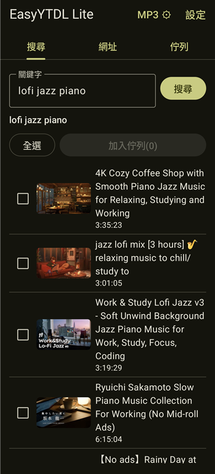
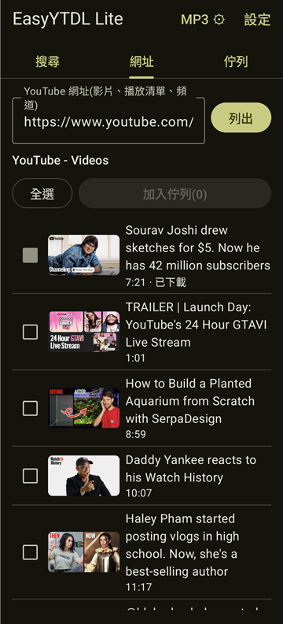
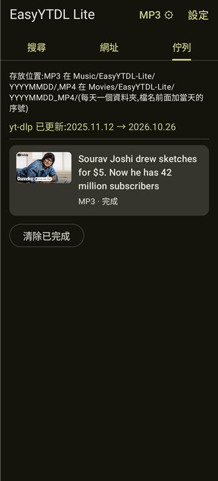
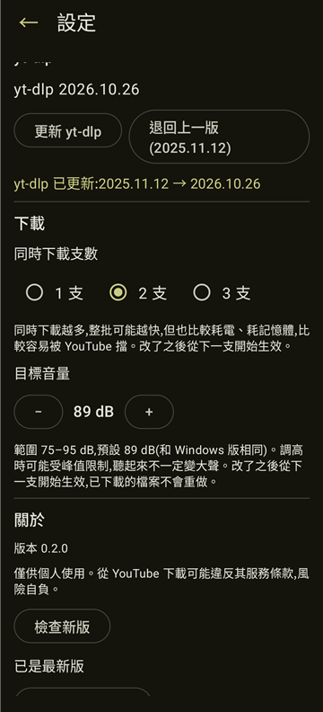

# EasyYTDL Lite

桌面與分享選單上顯示的名稱是「**YT下載Lite**」(專案、套件名與儲存資料夾仍叫 EasyYTDL-Lite)。

> ⚠️ **僅供個人使用。從 YouTube 下載可能違反其服務條款,風險自負。**

Android App:搜尋 YouTube 影片,或貼上影片、播放清單、頻道網址,下載成 MP3 或 MP4 存在手機裡,給其他播放器 App 播放。
**不需要登入、不需要任何金鑰。**

這是 EasyYTDL 的免登入版:拿掉了需要 Google 帳號的訂閱與最新影片,改用 yt-dlp 直接列出搜尋結果、播放清單與頻道影片。

## 功能

- **搜尋**:輸入關鍵字,列出 20 支影片,勾選後加入佇列。
- **網址**:貼上影片、播放清單或頻道網址,列出影片(頻道列最近 30 支)勾選下載;單支影片自動勾選。
- **分享**:在 YouTube App 對影片、播放清單或頻道按「分享」→ YT下載Lite,會開到「網址」分頁列出(單支影片自動勾選);在標題列選好 MP3 或 MP4 後按「加入佇列」。
- **MP3**:192 kbps,依 ReplayGain 正規化到設定的目標音量(預設 89 dB),存到 `Music/EasyYTDL-Lite/YYYYMMDD/`,檔名是 `nn_標題.mp3`(`nn` 是當天的序號)。
- **MP4**:解析度上限 1080p / 720p / 480p / 360p,合併影音軌但不重新編碼,存到 `Movies/EasyYTDL-Lite/YYYYMMDD_MP4/`。
- **佇列**:背景下載,同時 1–3 支(預設 2);格式與解析度在標題列的「MP3 ⚙」切換。
- **yt-dlp**:第一次下載前自動更新一次;下載失敗顯示「YouTube 拒絕」時,到「設定」按「更新 yt-dlp」。
- **更新**:每天自動檢查一次 GitHub 上的最新版,有新版就提示;按「更新」由 App 下載、比對 SHA-256 後交給系統安裝(需要允許「安裝不明應用程式」一次)。

## 畫面

| 搜尋 | 網址(頻道) | 佇列 | 設定 |
| --- | --- | --- | --- |
|  |  |  |  |

## 安裝(給朋友)

需求:**Android 10 以上、64 位元(arm64)手機**。32 位元的舊手機裝不了。

1. 用手機瀏覽器打開本 repo 的 [Releases](https://github.com/jmh273/EasyYTDL-Lite/releases/latest) 頁,點 `app-release-v<版號>.apk`(約 60 MB)下載。
2. 下載完點通知或到「檔案」App 的「下載」資料夾點開 APK。
3. 第一次會跳出「基於安全考量,你的手機目前無法安裝來自這個來源的不明應用程式」:點「設定」,打開「允許這個來源的應用程式」,再按返回。
4. 按「安裝」。Play 安全防護若跳出「未知的應用程式」警告,點「更多詳細資料」→「仍要安裝」。
5. 打開 App。第一次下載時會要求通知權限:允許後可以在通知列看到進度;不允許也會照常下載。

各廠牌手機的畫面文字略有不同,步驟相同。

**更新**:App 每天會自動檢查一次新版,有新版時主畫面上方會出現「有新版 X.Y.Z」。按「更新」,App 會下載新版並開啟系統的安裝畫面;第一次會先帶你到「安裝不明應用程式」設定頁,允許後回來再按一次「更新」。安裝會直接覆蓋舊版、保留設定與下載紀錄。也可以到「設定」→「檢查新版」手動檢查。

0.2.0 以前的版本沒有 App 內更新,要照上面的步驟手動裝一次 0.2.1 以後的版本。

權限:網路、前景服務、通知,以及 App 內更新用的「安裝不明應用程式」(只在按「更新」時使用)。不需要儲存權限。

可以和 EasyYTDL(桌面名稱「YT下載」)裝在同一支手機:兩者是不同的 App,檔案存在不同資料夾。

## 建置與測試

在 `mobile/android/` 執行(需要 JDK 17 以上與 Android SDK):

```bash
./gradlew :app:testDebugUnitTest   # JVM 單元測試
./gradlew :app:assembleDebug       # debug 版:套件名 com.jmh273.easyytdllite.debug,名稱「YT下載Lite(測試)」
sh ../scripts/check-no-google-auth.sh app/build.gradle app/build/outputs/apk/debug/app-debug.apk   # 不得含 Google 授權函式庫
```

版號唯一來源:`mobile/android/gradle.properties` 的 `VERSION_NAME`(versionCode = MAJOR*10000 + MINOR*100 + PATCH)。
需求的完整描述在 [openspec/specs/](openspec/specs/)。

## 發版

由 `.github/workflows/mobile-release.yml` 負責:推 `mobile-v<版號>` tag ⇒ CI 驗證、建置、驗 APK 簽章與版號、確認不含 Google 授權函式庫 ⇒ 建立 GitHub Release。
手動觸發預設 `dry_run`:只建置與驗證,不發佈。

1. 一次性設定(使用者親手,在 repo 根目錄自己的終端機執行):
   - `bash mobile/scripts/setup-signing.sh`:建立 release keystore 並設定 GitHub secrets / variables。
   - 🔴 keystore 與密碼要備份到「版控之外、本機之外」的兩處。遺失就無法再發出可覆蓋安裝的更新。
2. 每次發版:改 `VERSION_NAME` 並提交 ⇒ `git tag mobile-v<版號>` ⇒ `git push origin mobile-v<版號>`。

與 kit 範本的差異、以及從 EasyYTDL 複製時改的地方,見 [mobile/KIT-DIFF.md](mobile/KIT-DIFF.md)。

## 授權

- 本 repo 以 **GPL-3.0** 授權,全文見 [LICENSE](LICENSE)。
- 使用的 `youtubedl-android`、ffmpeg 也是 GPL-3.0;APK 的完整原始碼即本 repo,公開提供。
- 下載核心(yt-dlp 參數、youtubedl-android 版本)的修正要同步到 EasyYTDL 與 Windows 版(YT2MP3-Lite)。
